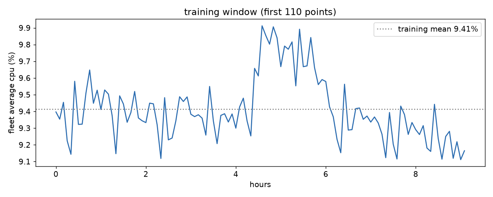
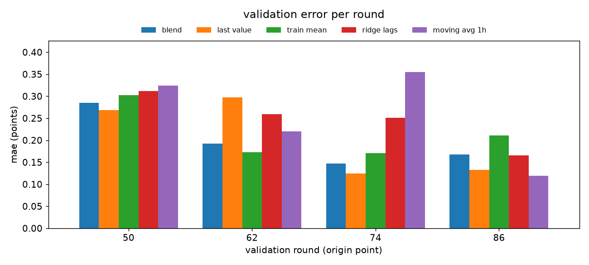
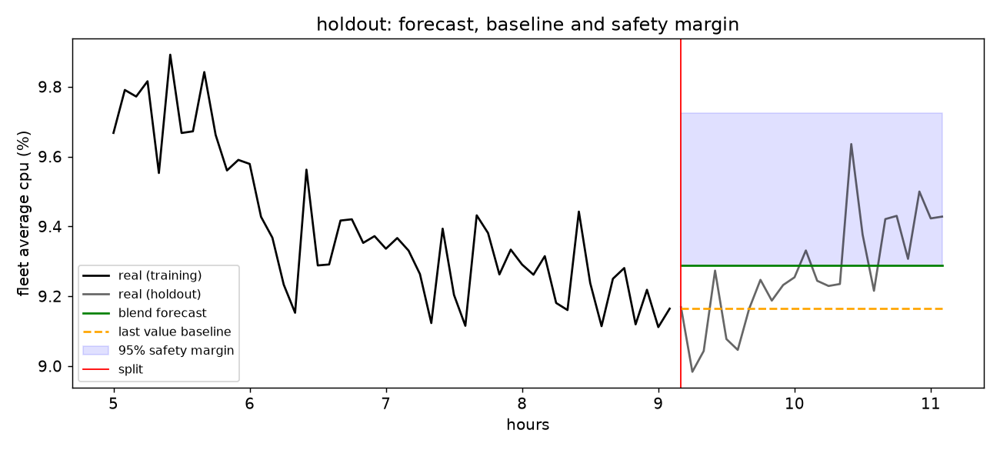

# Cloud Workload Forecasting: Final Report

Mohamed Zane Rahmeh

## 1. Executive summary

The task: forecast the next 2 hours (24 five minute points) of two fleet level series built from 10,000 Azure VMs, and turn the forecast into a capacity recommendation.

**How predictable is the workload?** At a 2 hour horizon the fleet average CPU is a stable level with zigzag noise on top. It stayed between 9.1% and 9.9% for the whole training window. The level is predictable within about 2%. The 5 minute moves are mostly noise: they reverse more often than they continue.

**How accurate is the forecast?** The final method, a blend of the last value and the training mean, beat the last value baseline in time aware validation (MAE 0.198 vs 0.206) and on the untouched holdout (MAE 0.124 vs 0.147, about 15% better, normalized MAE 0.848). It is almost unbiased on the holdout (+0.02 points). A ridge regression on lag features was tested and lost in validation, because the moves it tries to follow are noise. The active VM count is constant at 10,000 because of how the dataset was selected, so its last value forecast is exact.

**What should the team do?** Plan fleet capacity at forecast + 4.7%. This margin was sized only from validation errors, and it covered all 24 holdout points. Delay insensitive work can run with a cheaper +3.5% margin. Individual VMs should be sized on their own peaks, not on the fleet average, because single machines spike 2x within 5 minutes and 5 to 7x over their lifetime.

## 2. Data understanding and preprocessing

**Data.** `vm_cpu_readings.csv.gz` has 1,340,000 rows: 10,000 VMs × 134 timestamps, 300 seconds apart, covering about 11.1 hours (timestamps 0 to 39,900 s). `vm_metadata.csv.gz` has one row per VM: category, core and memory buckets, creation and deletion time, and lifetime CPU statistics.

**Quality checks** (all on the raw readings):

| check | result |
|---|---|
| missing values | none |
| duplicate (vm_id, timestamp) pairs | 0 |
| time gaps | all 133 gaps exactly 300 s, no holes |
| value range | all min, avg and max CPU within [0, 100] |
| consistency | min ≤ avg ≤ max in all 1,340,000 rows |

So no cleaning, filling or resampling was needed, and the native 5 minute cadence was kept. The pipeline still handles the general case: duplicate readings for the same VM and timestamp are averaged into one, and readings with a missing `avg_cpu` are ignored rather than filled in.

**Targets.** For each timestamp:

* `active_vm_count` = number of distinct VMs with a valid reading.
* `aggregate_cpu_utilization` = mean of the VM level `avg_cpu`, each VM counted once, clipped to [0, 100].

Both series were built in full first, then split chronologically: the first 110 points for training, the last 24 as the holdout.

**Selection bias.** Every VM reports at all 134 timestamps, so `active_vm_count` is exactly 10,000 everywhere. VM lifetimes from the metadata explain why. The shortest lifetime is 11.25 hours, just over the 11.1 hour window, and more than 75% of VMs ran for the whole 30 day trace. The challenge kept only VMs alive for the whole window. Short lived VMs, which are common in real fleets, were filtered out before we got the data. So the active count is flat because of the filter, not because real fleets are stable, and every result here describes long running VMs only.

**Leakage note.** The metadata CPU statistics (`avg_cpu`, `max_cpu`, `p95_max_cpu`) are computed over each VM's whole life, which includes the holdout period and beyond. They were used to describe segments, never as forecast features.

## 3. Workload analysis



**Level and shape.** The fleet average stays between 9.1% and 9.9% in training (mean 9.41%). There is one busy period between about 4.5 and 6 hours (peak 9.91% at hour 4.58), then the line drifts back down. The training window ends near its lowest point (9.11% at hour 9.0, one step before the split). There is no repeating pattern: 11 hours cannot contain a daily cycle, so seasonal naive forecasting is not possible.

**Distribution across VMs.** Per VM average CPU is strongly skewed: median 5.5%, mean 9.4%, max 99.3%. Most VMs are oversized, which is a downsizing opportunity. A small group runs hot, and the fleet average hides them completely.

**Segments** (lifetime statistics from the metadata):

| category | VMs | mean avg CPU | median avg CPU |
|---|---|---|---|
| delay insensitive | 6,180 (62%) | 8.2% | 5.9% |
| interactive | 3,091 (31%) | 11.4% | 6.1% |
| unknown | 729 (7%) | 10.4% | 4.0% |

Judging by the mean, interactive VMs look busiest. Their median, however, is almost the same as delay insensitive. The higher mean comes from a small hot tail, not from the whole group being busier. That matters operationally: headroom should target the few hot interactive VMs, not every interactive VM.

| cores | VMs | median avg CPU | median p95 peak CPU |
|---|---|---|---|
| 2 | 7,534 | 6.3% | 22.4% |
| 4 | 1,908 | 3.7% | 25.1% |
| 8 | 486 | 5.5% | 36.6% |
| 24 | 62 | 8.7% | 34.1% |
| >24 | 10 | 4.7% | 67.6% |

There is no "bigger is busier" pattern in percentage terms. Peaks are 5 to 7 times the average, so sizing must use peaks. Example: a typical 8 core VM peaks at 36.6% ≈ 2.9 cores. On 4 cores that is about 73%, which fits with headroom. On 2 cores it would be about 146%, which does not fit. So 8 to 4 is a safe downsize and 8 to 2 is not. Buckets are ranges and the 24 and >24 groups are small, so this core math is approximate.

**Short spikes.** In the raw readings, the median 5 minute max CPU (9.1%) is about twice the median 5 minute average (5.1%). Single machines spike hard even inside one interval, and averages hide it.

## 4. Forecasting approach

Every method takes the training series and returns 24 forecasts:

* **last value** (persistence): repeat the last training value.
* **train mean**: repeat the mean of the training window.
* **moving average 1 h**: repeat the mean of the last 12 points.
* **ridge on lag features**: ridge regression (alpha 1.0) on the values 5, 10, 15, 30 and 60 minutes back, plus a rolling 1 hour mean computed only from past values. It forecasts recursively: each prediction becomes the newest lag for the next step.
* **blend** (final): the average of last value and train mean. The idea is to start from the current level but expect a pull back toward the normal level, as seen after the busy period in training.

Feature availability: every feature uses only values strictly before the point being predicted (lags are shifted, the rolling mean is shifted by one step), so each feature could be computed at the forecast origin. No calendar features were used, since 11 hours carries no usable calendar signal. Ridge alpha and the lag set were not tuned, because tuning on four small validation windows would only fit noise.

`active_vm_count` uses the last value forecast.

The final forecast is flat: 9.29% for all 24 timestamps. This is deliberate. Section 7 shows that the short term moves are not predictable, and that models trying to follow them do worse.

## 5. Validation methodology

Rolling origin evaluation with an expanding window, run only inside the first 110 points:

| round | train on points | forecast points |
|---|---|---|
| 1 | 0 to 49 | 50 to 73 |
| 2 | 0 to 61 | 62 to 85 |
| 3 | 0 to 73 | 74 to 97 |
| 4 | 0 to 85 | 86 to 109 |

Each round mirrors the production task: train only on the past, forecast the next 2 hours, score. The origins step forward by 1 hour, and the last round ends exactly where the holdout begins. The method was chosen on the mean of the four rounds. The holdout was opened once, at the end, only to report the final score. The starter `rolling_origin_splits` was not used as is, because its defaults (1 week of training, 1 day horizon) give zero rounds on 134 points.

Metrics: MAE, RMSE (which punishes large misses more), bias (mean of forecast minus real: positive means too high, negative means too low, i.e. under provisioning), and normalized MAE (MAE divided by the last value MAE). No percentage error was needed, since the target never comes near zero.

## 6. Results versus baseline



**Validation** (mean of 4 rounds):

| method | MAE | RMSE | bias |
|---|---|---|---|
| **blend** | **0.198** | **0.228** | +0.036 |
| last value | 0.206 | 0.239 | +0.067 |
| train mean | 0.214 | 0.243 | +0.005 |
| ridge on lags | 0.247 | 0.278 | +0.081 |
| moving avg 1 h | 0.254 | 0.282 | +0.077 |

The blend is best on both MAE and RMSE, but the margin over last value is small (normalized MAE 0.96). What makes it the choice is consistency. Last value and train mean each win some rounds and lose others badly, while the blend is never the worst and is second best in three of four rounds. No more methods were tried after this, to avoid picking one that only got lucky on four windows.

**Holdout** (scored once, choice fixed in advance):

| method | MAE | RMSE | bias |
|---|---|---|---|
| ridge on lags | 0.106 | 0.142 | −0.035 |
| moving avg 1 h | 0.123 | 0.161 | −0.053 |
| **blend (final)** | **0.124** | **0.154** | **+0.020** |
| last value | 0.147 | 0.185 | −0.104 |
| train mean | 0.175 | 0.210 | +0.145 |

The blend beats the last value baseline by about 15% (normalized MAE 0.848) and is nearly unbiased. Last value is too low (bias −0.104), as the analysis predicted: training ended near its lowest point, so repeating it under provisions. Ridge scored best on this single window after losing every validation round. One 2 hour window is not enough to overturn four rounds of evidence, so the choice was not changed after seeing the holdout.

`active_vm_count`: forecast 10,000, actual 10,000 at all 24 points.

## 7. Error and failure analysis



**By horizon.** In the first hour the real line dipped to about 9.0%, and the blend (9.29%) was too high: MAE 0.129, bias +0.122. That is the safe side, wasted capacity. In the second hour the line climbed back to 9.4% to 9.6%, and the blend was too low: MAE 0.120, bias −0.081. That is the risky side. The error did not grow with the horizon. The failure is the shape: a flat line cannot follow a dip followed by a recovery.

**High load.** Defining high load as above the 75th percentile of training (9.508%, a threshold set without the holdout), only one holdout point qualifies: a short spike to 9.636% at hour 10.42. The blend missed it by 0.347 points (about 3.7% of the level), its worst miss. One point is not enough to judge peak performance in general, but it is the same failure the analysis predicted: short spikes are hidden by averages, and a flat forecast misses them.

**Why the model did not help.** In training, consecutive values are correlated (0.67) because the level persists. Consecutive changes, though, are negatively correlated (−0.42), with a typical move of about 0.16 points. The series zigzags around its level, so there is no short term trend to follow. Ridge tries to follow the moves and pays for it. Recursive forecasting adds to this, since every step builds on the previous guess, and the training windows are tiny (38 to 74 usable rows).

**How much room is left.** A flat forecast that knew the exact future average of each validation window, which is impossible in practice, would still score MAE 0.12. The blend scores 0.198. The remaining gap is about knowing the future level, not about following the moves.

**Failure modes:** (1) cannot follow up and down moves within the 2 hours, (2) misses short spikes. Both are why the recommendation adds a margin rather than trusting the point forecast.

## 8. Capacity planning recommendation

The margin is the 95th percentile of the blend's misses (real minus forecast) across the 96 validation points. It was chosen before the holdout was opened and only checked on it afterwards:

| policy | margin | holdout covered | average unused capacity |
|---|---|---|---|
| 80% | +0.19 pts (+2.0%) | 22 of 24 | 0.21 pts |
| 90% | +0.32 pts (+3.5%) | 23 of 24 | 0.34 pts |
| **95% (chosen)** | **+0.43 pts (+4.7%)** | **24 of 24** | **0.46 pts** |
| max | +0.51 pts (+5.5%) | 24 of 24 | 0.53 pts |

**Policy:**

1. **Fleet:** provision for forecast + 4.7%. On the holdout this covered every point, including the spike at hour 10.4.
2. **Segment rule:** keep the 95% margin for interactive workloads, where a user feels a shortage immediately. Delay insensitive jobs can queue, so the 90% margin (+3.5%) is enough and cheaper.
3. **Single VMs:** do not size individual machines from the fleet forecast. Use each VM's own peaks (p95), and watch the small hot tail of interactive VMs. Downsize where peaks allow, for example 8 cores to 4 for a typical 8 core VM, never by averages alone.
4. **Operations:** refresh the forecast every 5 to 15 minutes, and trigger scale up when real usage crosses forecast + margin.

**The trade off.** Under provisioning means slow or failing services and users who notice right away. Over provisioning means paying for idle capacity. Going from the 90% to the 95% margin costs about 1.2 extra percentage points of capacity and bought coverage of the one spike. That is worth it for user facing work, and not necessarily for background jobs.

## 9. Limitations and future work

**Limitations**

* **11 hours of data.** Daily and weekly cycles, which usually dominate cloud workloads, cannot be observed or modeled.
* **Selection bias.** Only VMs alive for the whole window are included, so churn is invisible and the fleet looks more stable than reality. A real deployment would need its own forecast of `active_vm_count`.
* **Target definition.** The target is a mean of percentages, so a 2 core VM counts as much as a 24 core VM. It measures how full a typical VM is, not total CPU demand in cores.
* **Small evidence.** Four validation rounds and one 24 point holdout. The blend's validation edge is small. The margin comes from 96 errors in a single window and should be recalculated as data grows.
* **Lifetime metadata statistics** include future periods. They were used only for description.

**Future work**

* With weeks of data: seasonal lags (same time yesterday, same time last week), calendar features, and models able to use them (gradient boosting on lags, or sequence models). Those become worth testing once there is a pattern to learn.
* Forecast total demand in cores (CPU % × VM size) instead of the mean percentage, which maps directly to capacity.
* Segment level forecasts (interactive vs delay insensitive) with separate margins.
* Prediction intervals from more validation windows, and a separate churn forecast for `active_vm_count`.

## Reproducibility

```bash
pip install -e ".[dev]"
python -m pytest -q
python -m cwfc.predict --data challenge_data --output predictions.csv
python -m cwfc.evaluate --data challenge_data
python reports/make_figures.py --data challenge_data
```

`cwfc.evaluate` reproduces every table in sections 6 and 8, and `make_figures.py` rebuilds the three figures. The full analysis is in `notebooks/exploration.ipynb`.
